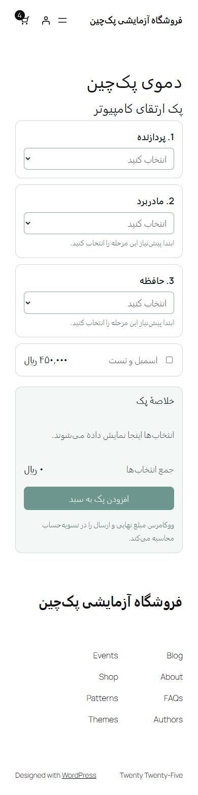

# Packchin Cart Integrity

A failed kit item should leave the cart as it was, and a repeated request should leave it with one copy. This fixture exercises the original **Packchin 0.1.0** cart transaction and quote path against native WooCommerce cart lines.

## Cart verification preview

  
   
  <em>Native WooCommerce cart snapshot and the four recorded fixture checks</em>

View the original mobile storefront

  
   
  <em>Original RTL storefront · mobile fixture</em>

## Run the fixture

Create a local disposable WordPress site with WooCommerce and set `CODEXAWP_TEST_WP_LOAD` to its `wp-load.php`. Run `php tests/check.php` from the repository. The fixture creates and publishes a two-product kit, verifies that repeating a request adds no duplicates, changes a price, and injects a failure on the second line to verify the original cart stays intact.

Start with [the cart adapter](src/Features/Commerce.php) and [the fixture](tests/check.php). The included supporting classes are the subset used by the fixture. GPL-2.0-or-later, see [LICENSE](LICENSE).

To render the same report from a fresh verification run, use `php tests/check.php --html > report.html` and open the generated file in a browser.

[Cart integrity fixture results](docs/verification.txt)
